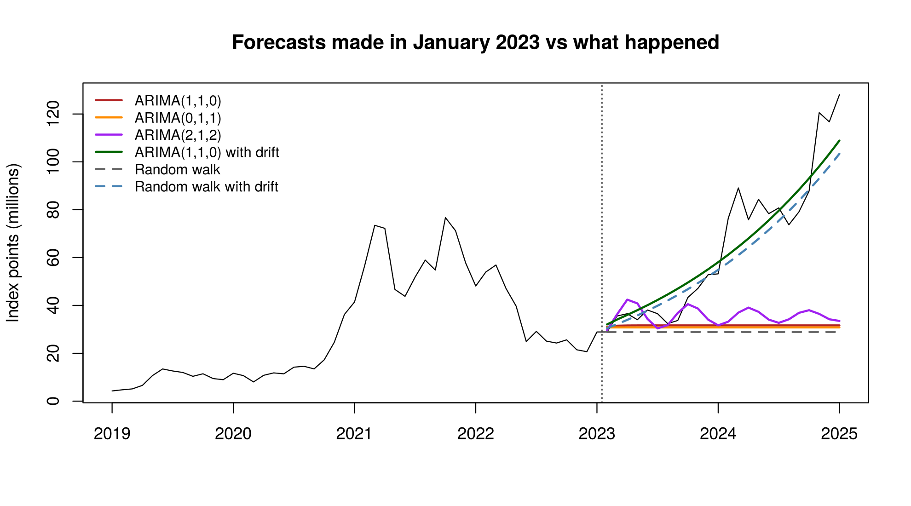
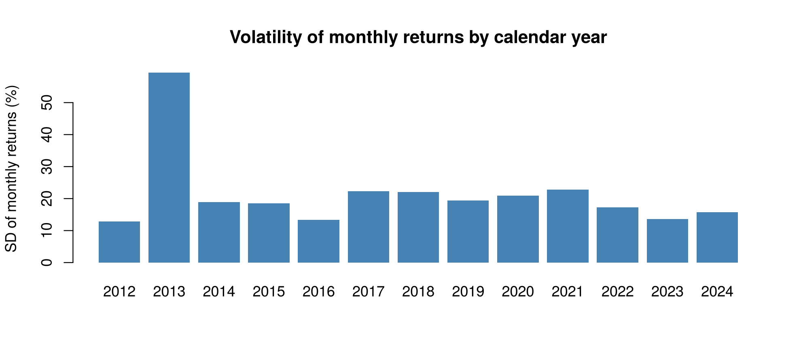

# Bitcoin Index: Does ARIMA Beat a Random Walk?

A monthly Bitcoin index (August 2011 to January 2025) modelled with ARIMA in R, then tested on 24 months of data the models never saw.

**[View the full report (live)](https://minhphucleluke.github.io/time-series-forecasting-r/bitcoin/bitcoin-forecasting-report.html)** · [R Markdown source](./bitcoin_forecasting.Rmd) · [Original full write-up (PDF)](./original-full-report.pdf)



## Key findings

- **Model fit is not forecasting skill.** ARIMA(1,1,0) on a Box-Cox (near-log) scale has the best AIC and BIC. On held-out data it does no better than a random walk: month by month its error is 6% higher, and the difference is not significant (Diebold-Mariano p = 0.36).
- **Drift is what mattered over two years.** Forecasting February 2023 to January 2025 from January 2023, adding a steady upward trend cut the error by about three quarters (MAPE 12% for a random walk with drift against 41% for ARIMA(1,1,0) without it).
- **No volatility clustering to model at monthly frequency.** The ARCH effect in a GARCH(1,1) fit is effectively zero (alpha = 0.002, p = 0.69), and a constant-variance model has the lower AIC and BIC. What the data does show is a fall in volatility: above 59% a month in 2013, and roughly 13 to 23% a month since 2014.
- **A year ahead, the model admits it cannot say much.** The upper end of the 95% forecast interval for January 2026 is about 25 to 30 times the lower end.



## Method

| Step | What was done |
|---|---|
| Transformation | Box-Cox, lambda = 0.05 (estimated with `TSA::BoxCox.ar`), then one regular difference; ADF p = 0.01 |
| Candidate models | ARIMA(1,1,0), ARIMA(0,1,1), ARIMA(2,1,2) from ACF, PACF, EACF and BIC table; ARIMA(1,1,0) with drift added |
| Out-of-sample test | Train Aug 2011 to Jan 2023, test Feb 2023 to Jan 2025; one 24-month forecast and 24 rolling one-month forecasts |
| Benchmarks | Random walk; random walk with drift |
| Accuracy | RMSE, MAE, MAPE, MAE relative to random walk; Diebold-Mariano test |
| Volatility | McLeod-Li test, Ljung-Box on squared returns, AR(1)-GARCH(1,1) with Student-t errors vs constant variance |
| Forecast | 12 months ahead with 80% and 95% intervals, with and without drift |

## Data

`data/bitcoin_index.csv`: monthly Bitcoin index supplied with the course data, 162 months. It tracks Bitcoin's price level but is an index, not the USD price of one coin.

## Run it yourself

```r
install.packages(c("forecast", "TSA", "tseries", "rugarch", "rmarkdown", "knitr", "kableExtra"))
rmarkdown::render("bitcoin_forecasting.Rmd")
```

## Tools

`R` · `forecast` · `TSA` · `tseries` · `rugarch` · `R Markdown`
