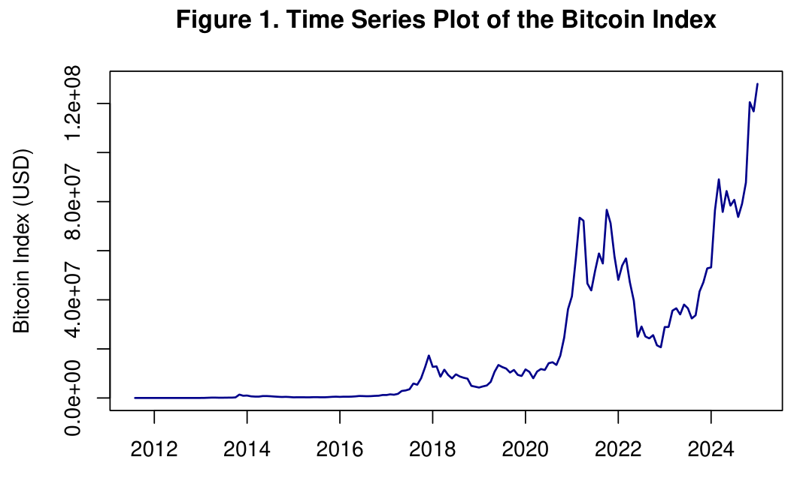
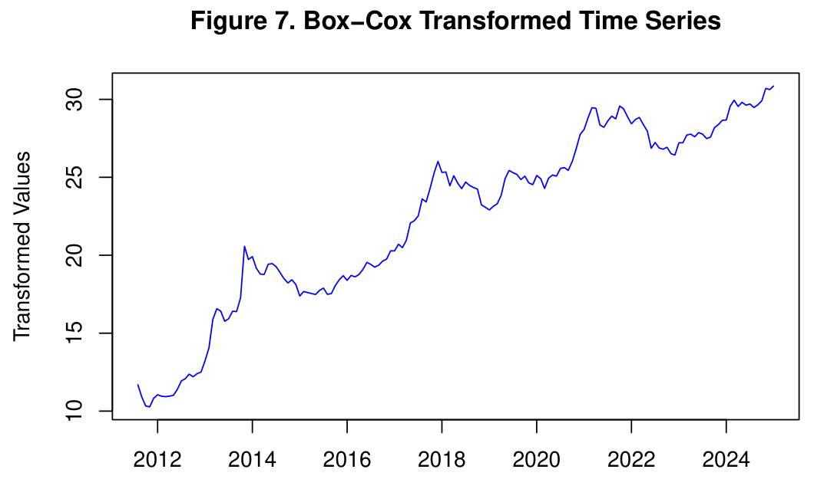

# Bitcoin Index Time Series Analysis

ARIMA modelling of a monthly Bitcoin index from August 2011 to January 2025 (162 months) in R: exploratory analysis, variance stabilisation, model specification, parameter estimation and model selection.

**[Read the full report (PDF, 28 pages)](./bitcoin-index-time-series-analysis.pdf)**

## Key findings

- **The series is strongly non-stationary.** It trends upward with variance that grows over time and a right-skewed distribution (skewness 1.66). The ADF (p ≥ 0.99), KPSS (p < 0.01) and Phillips-Perron (p = 0.96) tests all point to non-stationarity, and the Shapiro-Wilk test rejects normality.
- **A near-log transformation plus one difference fixes it.** A Box-Cox transformation with lambda ≈ 0.05 stabilises the variance, and first differencing makes the transformed series stationary (ADF statistic −4.90, p ≤ 0.01).
- **Eight candidate models, three retained.** ACF and PACF plots, the EACF table and a BIC subset table proposed eight ARIMA models. Coefficient tests under ML and CSS estimation kept three: ARIMA(1,1,0), ARIMA(0,1,1) and ARIMA(2,1,2).
- **ARIMA(1,1,0) is the selected model.** It has the lowest AIC (260.37) and BIC (266.53), a significant AR(1) coefficient (0.189, p = 0.015) and in-sample accuracy almost identical to the other two (MASE ≈ 0.176), with one parameter, joint fewest with ARIMA(0,1,1).

## Method

| Stage | What was done |
|---|---|
| Exploration | Descriptive statistics, time series plot, STL decomposition, lag-1 scatter plot, rolling mean and standard deviation |
| Stationarity | ADF, KPSS and Phillips-Perron tests; ACF and PACF; Q-Q plot and Shapiro-Wilk test |
| Transformation | Box-Cox (lambda ≈ 0.05), then first differencing |
| Specification | ACF/PACF, EACF and BIC subset table to propose candidate ARIMA(p,1,q) models |
| Estimation | ML, CSS and CSS-ML estimation with coefficient significance tests |
| Selection | AIC and BIC comparison, in-sample accuracy (RMSE, MAE, MAPE, MASE) |

## Model comparison

| Model | AIC | BIC |
|---|---|---|
| **ARIMA(1,1,0)** | **260.37** | **266.53** |
| ARIMA(0,1,1) | 261.05 | 267.21 |
| ARIMA(2,1,2) | 265.87 | 281.27 |

## Limitations and next steps

The model uses only the series' own past, so regulation, market conditions and technology changes are outside it, and it has no built-in way to handle the structural breaks visible in the data. The report suggests ARIMAX models with external variables, GARCH models for the changing variance, non-linear models and a multivariate view across several cryptocurrencies.

## Follow-up: testing the model on unseen data

After the report, I tested ARIMA(1,1,0) on the last 24 months of data, fitting it only on the earlier years, and compared it with a random walk.

**[View the follow-up analysis (live)](https://minhphucleluke.github.io/time-series-forecasting-r/bitcoin/follow-up/bitcoin-forecasting-report.html)** · [R Markdown source](./follow-up/bitcoin_forecasting.Rmd)

- Month to month, ARIMA(1,1,0) forecast no better than a random walk (the difference was not significant, Diebold-Mariano p = 0.36).
- Over the full two years, adding a steady upward drift cut the forecast error by about three quarters.
- At monthly frequency, a GARCH model did not improve on constant variance. Volatility has no steady trend: 2013 was an outlier at above 59% a month, while every other year from 2012 to 2024 sat at roughly 13 to 23% a month.

## Data

`data/bitcoin_index.csv`: monthly Bitcoin index, August 2011 to January 2025, supplied with the course data.

## Tools

`R` · `forecast` · `TSA` · `tseries` · `lmtest` · `R Markdown`
