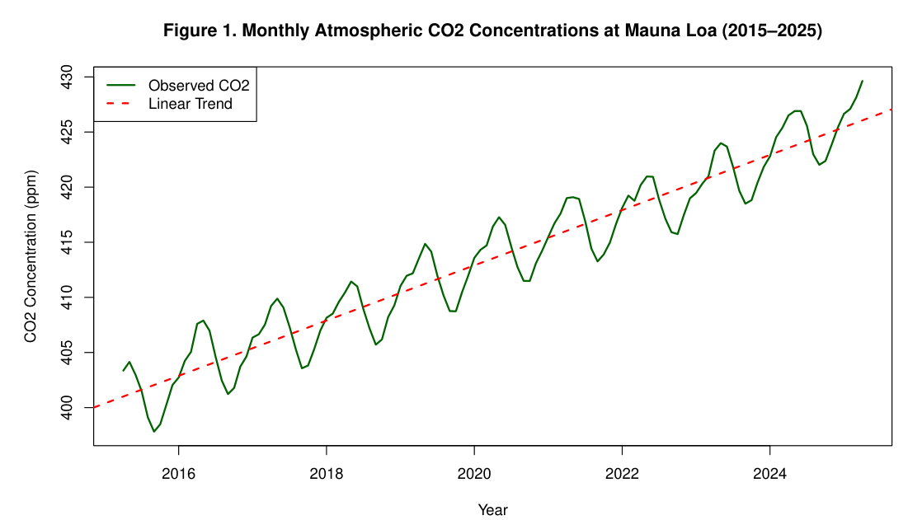
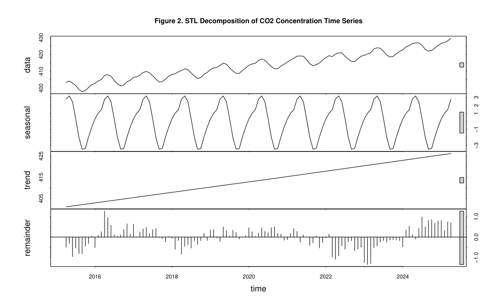

# Global CO2 Concentration Time Series Analysis and Forecasting

Seasonal ARIMA modelling of monthly atmospheric CO2 at the Mauna Loa Observatory from April 2015 to April 2025 (121 months) in R, ending in a 10-month forecast.

**[Read the full report (PDF, 68 pages)](./global-co2-time-series-analysis.pdf)**

## Key findings

- **A steady rise with a strong yearly cycle.** CO2 rose from 403.4 ppm to 429.6 ppm over the period (mean 413.5 ppm), with a regular seasonal peak around May and low around September to October.
- **Differencing chosen with care.** Formal stationarity tests (ADF, KPSS, Phillips-Perron, DF-GLS) and visual diagnostics disagreed, so the series was given a second-order regular difference and a seasonal difference. Log and Box-Cox transformations were considered and not needed, because the variance was already stable.
- **Eight SARIMA candidates compared.** Models of the form SARIMA(p,2,q)(0,1,1)[12] were fitted and their coefficients tested under ML and CSS estimation. SARIMA(1,2,2)(0,1,1)[12] had the lowest AIC (139.59), and SARIMA(0,2,2)(0,1,1)[12] the lowest BIC (151.95, with SARIMA(1,2,2) close behind at 152.95).
- **SARIMA(1,2,2)(0,1,1)[12] is the selected model.** It has the best AIC, strong in-sample accuracy (RMSE 0.389 ppm, MAE 0.306 ppm, MASE 0.117), residuals with no remaining autocorrelation, and normally distributed residuals. An over-parameterised SARIMA(2,2,2) added a coefficient that was not significant (p = 0.74). GARCH was considered, but the residuals showed no changing variance to model.
- **The forecast: 430 ppm within ten months.** The 10-month forecast from May 2025 to February 2026 keeps the seasonal pattern and the upward trend, starting at 430.4 ppm in May 2025, dipping to 425.0 ppm in September 2025 and returning to 430.4 ppm by February 2026.

![SARIMA(1,2,2)(0,1,1)[12] forecast](report-figures/03-sarima-forecast.png)

## Method

| Stage | What was done |
|---|---|
| Exploration | Descriptive statistics, time series plot with linear trend, STL decomposition, lag scatter plots |
| Stationarity | Rolling statistics; ADF, KPSS, Phillips-Perron and DF-GLS tests; seasonal ACF |
| Transformation | Log and Box-Cox considered (lambda ≈ 2) and not applied; first, second and seasonal differencing compared |
| Specification | ACF, PACF and EACF of the differenced series; BIC subset selection on residuals |
| Estimation | Eight SARIMA(p,2,q)(0,1,1)[12] models fitted with ML, CSS and CSS-ML; coefficient tests |
| Selection | AIC and BIC, in-sample accuracy, residual diagnostics, over-parameterisation check |
| Forecast | 10 months ahead with 80% and 95% prediction intervals |

## Follow-up: checking the forecast against reality

The report's forecast ended in February 2026. NOAA has since published readings up to September 2026, so I compared the forecast with what was actually measured, and tested the model on a 24-month holdout.

**[View the follow-up analysis (live)](https://minhphucleluke.github.io/time-series-forecasting-r/co2/follow-up/co2-forecasting-report.html)** · [R Markdown source](./follow-up/co2_forecasting.Rmd)

- The 430 ppm call was right: NOAA's May 2025 monthly mean was 430.51 ppm.
- All 17 NOAA readings from May 2025 to September 2026 fell inside the model's 95% prediction band.
- After the first month the forecast ran high in every month, and the gap reached almost 2 ppm (1.97 ppm in July 2026). On the 24-month holdout test, the selected model was the least accurate of the SARIMA models compared. A model with a steady trend (one regular difference) tracked the actual readings more closely.

## Data

- `data/co2_mlo_2015_2025.csv`: monthly mean CO2 at Mauna Loa, April 2015 to April 2025, used in the report
- `data/co2_mlo_noaa_latest.csv`: the full NOAA monthly record downloaded in November 2026, used in the follow-up

Source: Dr. Xin Lan, NOAA/GML ([gml.noaa.gov/ccgg/trends](https://gml.noaa.gov/ccgg/trends/)) and Dr. Ralph Keeling, Scripps Institution of Oceanography ([scrippsco2.ucsd.edu](https://scrippsco2.ucsd.edu/)).

## Tools

`R` · `forecast` · `TSA` · `tseries` · `urca` · `lmtest` · `R Markdown`
