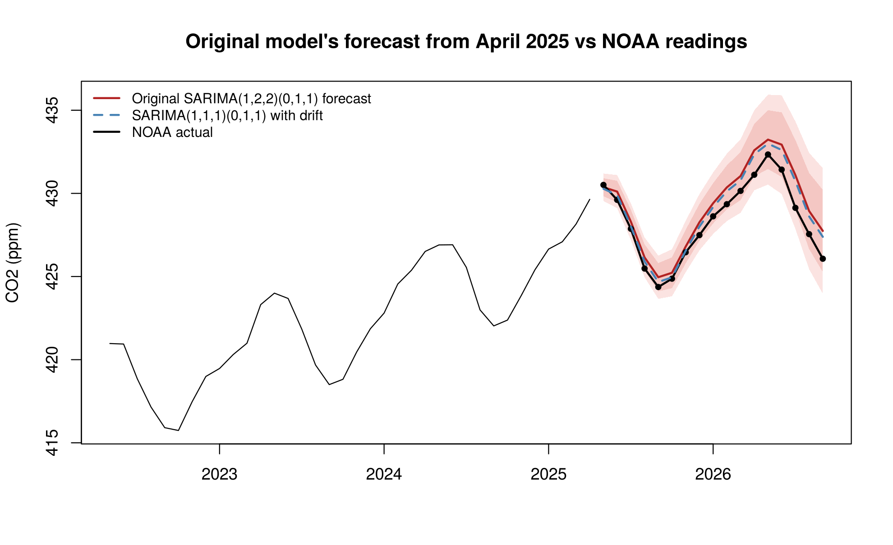
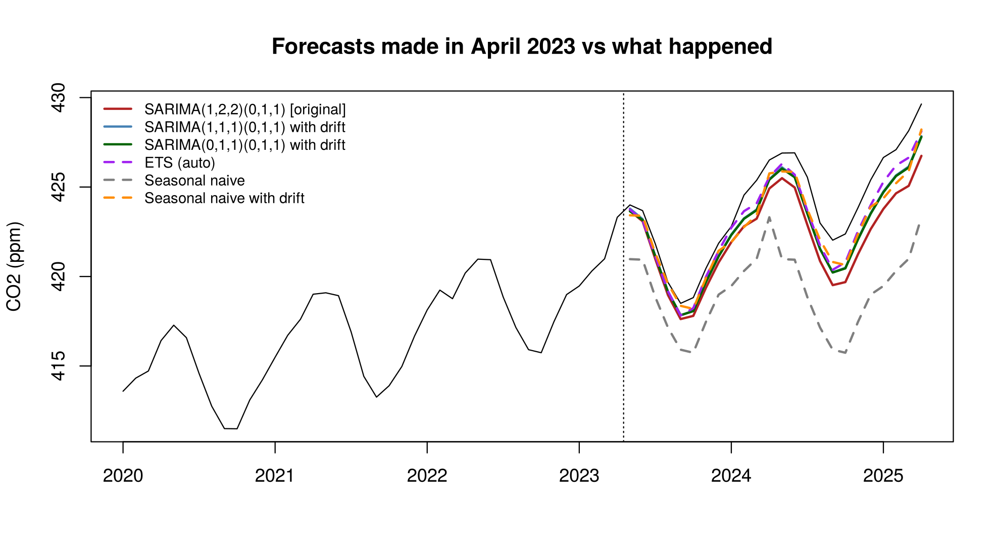

# Global CO2: A SARIMA Forecast Checked Against Reality

Monthly atmospheric CO2 at Mauna Loa (April 2015 to April 2025) modelled with seasonal ARIMA in R. The model's forecasts are then compared with 17 months of NOAA readings published after the study ended.

**[View the full report (live)](https://minhphucleluke.github.io/time-series-forecasting-r/co2/co2-forecasting-report.html)** · [R Markdown source](./co2_forecasting.Rmd) · [Original full write-up (PDF)](./original-full-report.pdf)



## Key findings

- **The forecast held up.** All 17 NOAA monthly readings from May 2025 to September 2026 fell inside the original model's 95% forecast band. Its average error was about 0.9 ppm.
- **But it ran high, and the gap grew.** The original SARIMA(1,2,2)(0,1,1)[12] uses two regular differences, which lets the trend keep accelerating. Its first forecast was within 0.2 ppm, but after that it was above the actual value in every month, by more than 1.5 ppm by mid 2026.
- **A simpler trend did better.** SARIMA(1,1,1)(0,1,1)[12] with drift, which assumes a steady rise, cut the error against reality by about a fifth (RMSE 0.80 ppm against 1.04).
- **The holdout test pointed the same way.** Forecasting May 2023 to April 2025 from data up to April 2023, the original model had the highest error of the SARIMA models (RMSE 1.98 ppm). ETS was most accurate (1.10 ppm), and even a seasonal naive forecast with drift (1.31 ppm) beat the original model.
- **430 ppm arrived on schedule.** The original report expected monthly CO2 to pass 430 ppm within ten months. NOAA's May 2025 monthly mean was 430.51 ppm.



## Method

| Step | What was done |
|---|---|
| Original model | SARIMA(1,2,2)(0,1,1)[12], chosen by AIC, BIC and residual diagnostics |
| Alternatives | SARIMA(1,1,1)(0,1,1)[12] and SARIMA(0,1,1)(0,1,1)[12] with drift; ETS (automatic); seasonal naive with and without drift |
| Holdout test | Train Apr 2015 to Apr 2023, test May 2023 to Apr 2025 (24 months) |
| Reality check | Models fit on all study data to Apr 2025, forecasts compared with NOAA readings May 2025 to Sep 2026 |
| Accuracy | RMSE, MAE, MAPE, MASE (scaled by seasonal naive), mean error, 95% interval coverage |

## Data

- `data/co2_mlo_2015_2025.csv`: the study data, NOAA monthly mean CO2 at Mauna Loa, April 2015 to April 2025
- `data/co2_mlo_noaa_latest.csv`: the full NOAA monthly record downloaded in November 2026, used for the reality check. Revisions to the study period were at most 0.04 ppm.

Source: Dr. Xin Lan, NOAA/GML ([gml.noaa.gov/ccgg/trends](https://gml.noaa.gov/ccgg/trends/)) and Dr. Ralph Keeling, Scripps Institution of Oceanography ([scrippsco2.ucsd.edu](https://scrippsco2.ucsd.edu/)).

## Run it yourself

```r
install.packages(c("forecast", "tseries", "rmarkdown", "knitr", "kableExtra"))
rmarkdown::render("co2_forecasting.Rmd")
```

## Tools

`R` · `forecast` · `tseries` · `R Markdown`
